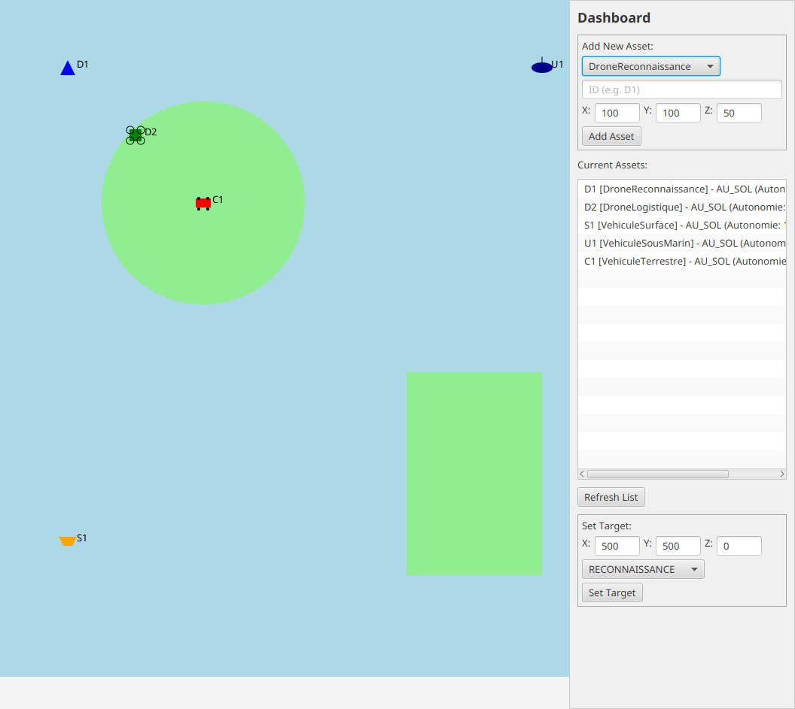

# SPIGA Simulator

[](https://github.com/odebrino/SPIGA/actions/workflows/ci.yml)
[](https://github.com/odebrino/SPIGA/actions/workflows/codeql.yml)
[](LICENSE)

SPIGA (Simulateur de Planification et de Gestion d'Actifs Mobiles) is a Java simulator for coordinating air, sea, and land assets. It combines grid-based A* pathfinding, collision checks, mission assignment, and JavaFX/CLI interfaces around a shared simulation core.



The map shows land/water regions and the current fleet. Assets have x/y/z positions; the displayed map and A* planning grid use an x/y projection. The dashboard supports adding assets and assigning targets.

[Architecture and implementation](docs/architecture.md) · [Reproducible demonstrations](docs/demonstrations.md)

## Run a repeatable example

Requires JDK 17 or 21 and Git. From a fresh clone:

```bash
git clone https://github.com/odebrino/SPIGA.git
cd SPIGA/spiga-simulator
./mvnw -B -ntp verify
./mvnw -q compile exec:java -Dexec.mainClass=com.spiga.ui.ConsoleInterface < ../docs/examples/cli-input.txt
```

This creates a logistics drone, assigns a named mission, advances one step, lists the resulting fleet state, and exits. It runs without a graphical display. [Verified input and transcript](docs/demonstrations.md).

The baseline audit passed **39 tests** on JDK 21, with JaCoCo reporting **46.2% line / 45.0% branch coverage**. [Revision, environment, and interpretation](docs/architecture.md).

## Engineering focus

The repository separates vehicle contracts and behavior, terrain/collision/pathfinding services, mission/fleet management, shared application bootstrap, and presentation. The same construction and compatibility rules support both front ends. Tests cover domain behavior, movement constraints, collisions, environment logic, mission coordination, and bootstrap behavior.

Maintained by [Rafael Ode Brino](https://github.com/odebrino). Implementation and change history are available in the repository; external dependencies retain their own attribution and licenses.

## Repository Layout

- `spiga-simulator/`: Maven Java project (source code, tests, build config)
- `.github/`: CI/CD workflows, issue templates, and automation config

## Requirements

- JDK 17 or newer
- Git

No global Maven installation is required. Use the Maven Wrapper included in this repo.

## Quick Start

```bash
git clone https://github.com/odebrino/SPIGA.git
cd SPIGA/spiga-simulator
./mvnw -B test
```

## Build and Verify

```bash
cd spiga-simulator
./mvnw -B verify
```

## Run the Simulator

### JavaFX UI

```bash
cd spiga-simulator
./mvnw javafx:run
```

### CLI Mode

```bash
cd spiga-simulator
./mvnw -B exec:java -Dexec.mainClass="com.spiga.ui.ConsoleInterface"
```

## Project Packages

- `com.spiga.core`: domain models and vehicle behavior
- `com.spiga.env`: terrain, collision, and pathfinding services
- `com.spiga.mission`: mission and fleet orchestration
- `com.spiga.app`: application bootstrap and wiring
- `com.spiga.ui`: JavaFX and CLI interfaces

## Quality and Automation

- GitHub Actions CI on pushes and pull requests
- Maven Enforcer for Java/Maven version checks
- Surefire/Failsafe pinned for reproducible test execution
- Jacoco reports generated during test phase
- Dependabot for dependency updates

## Contributing and Policies

- Contribution guide: [CONTRIBUTING.md](CONTRIBUTING.md)
- Code of conduct: [CODE_OF_CONDUCT.md](CODE_OF_CONDUCT.md)
- Security policy: [SECURITY.md](SECURITY.md)
- Support guide: [SUPPORT.md](SUPPORT.md)
- Changelog: [CHANGELOG.md](CHANGELOG.md)

## License

This project is licensed under the MIT License. See [LICENSE](LICENSE).
