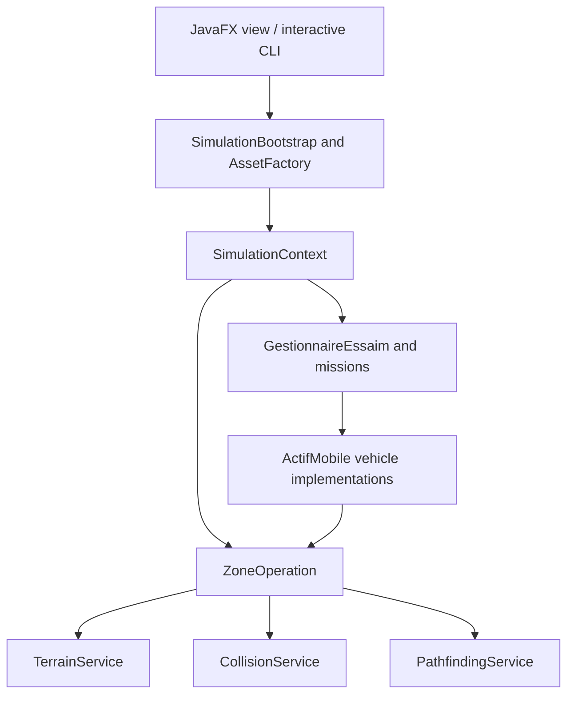

# Architecture and implementation

SPIGA separates vehicle behavior, environment queries, orchestration, and presentation.

| Package | Responsibility | Useful source |
| --- | --- | --- |
| `com.spiga.core` | Shared mobile-asset contracts and specialized air/sea/land behavior | `ActifMobile`, `DroneReconnaissance`, `VehiculeTerrestre` |
| `com.spiga.env` | Terrain compatibility, collision checks, path planning | `ZoneOperation`, `CollisionService`, `PathfindingService` |
| `com.spiga.mission` | Fleet lookup, mission assignment, mission state | `GestionnaireEssaim`, `Mission` |
| `com.spiga.app` | Common construction, validation, and coordination for both front ends | `AssetFactory`, `SimulationBootstrap` |
| `com.spiga.ui` | JavaFX display/dashboard and console interaction | `MainApp`, `ConsoleInterface` |

## Numerical and algorithmic scope

Assets have x/y/z positions and specialized movement constraints. The map is an x/y projection. `PathfindingService` implements eight-neighbor grid-based A* with cardinal/diagonal costs, a Euclidean heuristic, and land/marine compatibility checks. It is not a continuous 3D motion planner.

`CollisionService` evaluates obstacles and mobile-asset separation; bootstrap methods validate spawn/target compatibility before handing work to the fleet. Mission assignment and target propagation share orchestration helpers between the JavaFX and CLI entry points.

The implementation combines interfaces/inheritance for heterogeneous assets with separate environment services. The design can be explored through domain tests and the [reproducible demonstrations](demonstrations.md).

## Verification snapshot

On 24 October 2026, `./mvnw -B -ntp verify` passed with OpenJDK 21.0.12.1: 39 tests, zero failures/errors/skips. The baseline revision was `b125e454f394827b4ffa15b8758b2c45d74c0812`; the presentation/workflow update leaves simulation source unchanged.

JaCoCo reported 491/1,063 covered lines (46.2%) and 181/402 covered branches (45.0%). Coverage is an inventory of exercised code, not a complete correctness claim. The CI workflow checks JDK 17 and 21; the report artifact is attached to successful JDK 17 runs.
